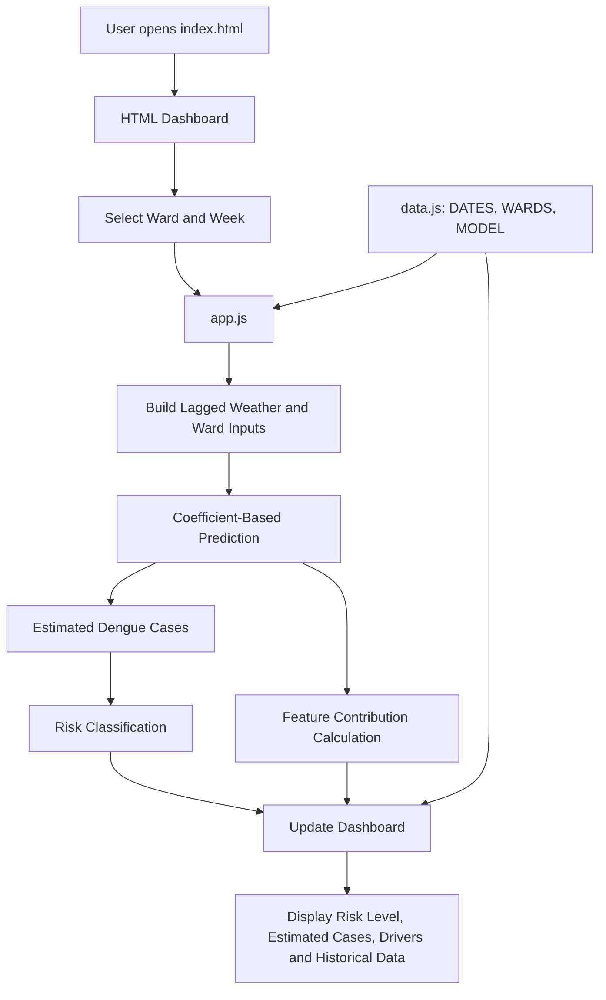

## 1. Project Overview

Dengu Helpline is a browser-based ward-level dengue risk dashboard. It allows users to select a ward and a particular week to view the estimated dengue cases and corresponding risk level.

The application uses weather information and ward-level attributes to calculate an estimated dengue case count. It then assigns a risk category and displays the prediction along with contributing factors and historical information.

The current project is a client-side prototype. The prediction coefficients and data are loaded from `data.js`. The browser does not train a machine-learning model at runtime.

**Important:** The current repository does not contain a backend/API or an automated dataset-ingestion pipeline.

---

## 2. System Architecture and Data Flow

The following diagram illustrates how the current application works.



### Main Components

| Component | Responsibility |
|---|---|
| `index.html` | Provides the dashboard structure, ward/week selectors, prediction results, driver section and tables. Loads `data.js` before `app.js`. |
| `style.css` | Controls the visual presentation and layout of the dashboard. |
| `data.js` | Supplies `DATES`, `WARDS` and `MODEL` data/configuration used by the browser. |
| `app.js` | Populates selectors, creates lagged inputs, calculates predictions and driver contributions, assigns risk tiers, and updates the dashboard. |
| `package.json` | Contains project dependency and run configuration. |
| `sript.js` | Contains separate login-page logic. It is not loaded by the dashboard `index.html`. |

---

## 3. Current Prediction Logic

For a selected ward and week, the application constructs the following input features:

1. Rainfall from 2 weeks earlier.
2. Rainfall from 3 weeks earlier.
3. Rainfall from 4 weeks earlier.
4. Temperature from 3 weeks earlier.
5. Relative humidity from 3 weeks earlier.
6. Ward water-logging value.
7. Ward sanitation value.
8. Population density, scaled by dividing it by 10,000.

### Prediction Process

The current `predict()` function in `app.js`:

1. Starts with the intercept value from `MODEL.intercept`.
2. Multiplies each input feature by its corresponding coefficient in `MODEL.coef`.
3. Adds the calculated values to estimate dengue cases.
4. Calculates feature contributions relative to the configured feature means in `MODEL.means`.
5. Ensures that the estimated case count is not negative.

### Risk Classification

The `tierFor()` function compares the estimated case count against the configured thresholds in `MODEL.cuts`.

It assigns one of four risk categories:

- Low
- Medium
- High
- Critical

The dashboard displays the estimated cases, risk category, contributing factors, recent weather history, ward attributes and recorded case values where available.

### Current Model Description

The current implementation uses a coefficient-based linear statistical scoring/regression calculation in JavaScript.

The inspected application code does not contain model-fitting or training code. Therefore, the current implementation should not be described as a trained Random Forest or another machine-learning model.

---

## 4. Validation Approach and Model Rationale

### Chronological Validation

Dengue forecasting involves time-dependent data. Randomly mixing past and future observations during evaluation can cause data leakage and produce misleading results.

For the next implementation stage, the recommended validation approach is chronological splitting.

```text
Earlier Weeks                         Later Weeks

|----------- TRAIN -----------|-- VALIDATION --|---- TEST ----|

       Model Training          Model Selection   Final Evaluation
```

The recommended process is:

1. Sort the observations by date or week.
2. Generate lag features using only information available before the prediction week.
3. Use the earliest period for training.
4. Use the next period for validation and model selection.
5. Reserve the latest period for final testing.
6. Fit preprocessing and model parameters using training data only.
7. Evaluate the final model using MAE and RMSE on the untouched test period.

The exact date boundaries and split proportions must be determined after inspecting the complete official dataset.

The current repository displays MAE/RMSE values from `MODEL`, but the inspected frontend code does not establish the underlying evaluation procedure or data split.

### Model Selection Rationale

The current coefficient-based approach is lightweight, fast and relatively easy to explain through feature contributions.

It provides a transparent baseline for the prototype.

For the next stage, the following models can be compared:

- Linear or statistical regression baseline.
- Tree-based regression model, such as Random Forest, if the dataset size and feature quality support it.

The final model should be selected based on:

- Chronological validation MAE.
- Chronological validation RMSE.
- Prediction stability across wards.
- Interpretability.

A model should not be claimed as more accurate than another until the comparison has actually been performed.

Risk-category thresholds should also be documented and validated against the available data.

---

## 5. System Efficiency

The current application has several lightweight characteristics:

- Data and prediction calculations run locally in the browser.
- The dashboard does not make repeated weather API calls.
- Prediction requires a small coefficient-based calculation.
- The current implementation does not require downloading a server-side model.

---

## 6. Current Limitations

The current prototype has some limitations:

1. The official dataset schema and complete data coverage still need to be verified.
2. The repository does not contain an automated data-ingestion pipeline.
3. The current code does not demonstrate model training.
4. The underlying validation procedure for the displayed MAE/RMSE values is not established by the inspected frontend code.
5. There is no production backend or automated model deployment pipeline.

---

## 7. Future Development Plan

The following improvements are required to develop the prototype into a more complete dengue forecasting system:

1. Verify the official spreadsheet's columns, date range, ward identifiers, target variable and missing values.
2. Build a reproducible data-ingestion and cleaning pipeline.
3. Generate lagged weather and ward-level features programmatically.
4. Train and compare statistical and machine-learning models using chronological training, validation and testing.
5. Select and save the best-performing model and its preprocessing steps.
6. Connect the selected model to the dashboard.
7. Record actual test MAE/RMSE, model version, data period and risk-category thresholds.
8. Add setup and execution instructions and test the project from a clean GitHub clone.

---

## 8. Current Implementation vs. Future Work

| Feature | Current Status |
|---|---|
| Dashboard interface | Implemented |
| Ward and week selection | Implemented |
| Local data loading | Implemented |
| Lagged input construction | Implemented |
| Coefficient-based prediction | Implemented |
| Risk classification | Implemented |
| Feature contribution display | Implemented |
| Automated dataset ingestion | Future work |
| Reproducible ML model training | Future work |
| Chronological model evaluation | Future work |
| Production backend/API | Future work |
| Automated model deployment | Future work |

---

## 9. Conclusion

Dengu Helpline is a preliminary ward-level dengue risk dashboard that combines weather-related inputs and ward-level attributes to estimate dengue cases and classify risk levels.

The current prototype demonstrates the dashboard interface, data handling, lagged input construction, coefficient-based prediction and risk visualization.

The next development stage will focus on verifying the official dataset, implementing a reproducible machine-learning workflow, performing chronological model evaluation and integrating the selected model into the dashboard.